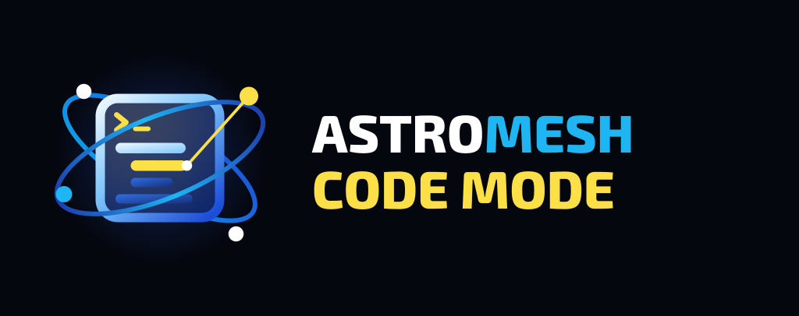

<p align="center">
  
</p>

# astromesh-codemode

**Dale a tu agente dos tools en lugar de doscientas, y dejá que escriba el pegamento en un sandbox.**

[](https://monaccode.github.io/astromesh/#ecosystem)
[](https://github.com/monaccode/astromesh-codemode/actions/workflows/ci.yml)
[](https://www.python.org/)
[](https://github.com/monaccode/astromesh-codemode/blob/main/LICENSE)

*[Read in English](https://github.com/monaccode/astromesh-codemode/blob/main/README.md)*

> **Estado: todavía no está en PyPI.** La 0.1.0 está construida y probada, pero no se
> publica hasta que corra el eval de nivel 2 (modelos reales) y su tabla esté en este
> README. Ver [Resultados](#resultados).

El tool calling clásico le manda al modelo el schema de cada tool en cada llamada, y cada
resultado de vuelta por la conversación. Con un catálogo grande, o una tool que devuelve 500
filas, la mayor parte del contexto son schemas y datos que el modelo solo necesitaba pasar
de un lado a otro.

Code Mode envuelve cualquier conjunto de tools detrás de dos:

- **`codemode_search(query)`** devuelve las tools que coinciden como stubs Python tipados
  (`async def get_customer(customer_id: int) -> dict:` más su descripción), rankeadas con BM25.
- **`codemode_run(code)`** corre un programa Python que escribió el modelo, donde cada tool
  es una función `async`. El programa corre en un sandbox
  [Monty](https://github.com/pydantic/monty) (sin sistema de archivos, sin red, sin
  procesos), con límites de tiempo, memoria, llamadas a tools y salida. Los resultados
  intermedios quedan en el sandbox; al modelo vuelve solo lo que el programa devuelve.

Funciona con funciones Python comunes, servidores MCP en vivo y ocho frameworks de agentes.
No depende de Astromesh; Astromesh lo va a integrar más adelante.

## Instalación

```bash
pip install astromesh-codemode                 # core: funciones Python, tu propio loop
pip install 'astromesh-codemode[langchain]'    # más un adapter de framework (ver abajo)
pip install 'astromesh-codemode[mcp]'          # tools MCP como fuente, y el proxy MCP
```

Hasta que la 0.1.0 esté en PyPI, instalalo desde un checkout: `uv sync` (o
`pip install -e .`). Python 3.11+.

## Inicio rápido

Cualquier función con type hints y docstring se vuelve una tool. Las funciones sync corren
en un thread.

```python
import asyncio

from astromesh_codemode import CodeMode
from astromesh_codemode.sources import from_function


def list_orders(limit: int = 10) -> list[dict]:
    """List recent orders: id, amount, customer_id."""
    return [{"id": i, "amount": 10 + i, "customer_id": i % 5 + 1} for i in range(1, limit + 1)]


def get_customer(customer_id: int) -> dict:
    """Get a customer by id: id and name."""
    return {"id": customer_id, "name": f"Customer {customer_id}"}


cm = CodeMode([from_function(list_orders), from_function(get_customer)])


async def main():
    print(await cm.search("orders"))  # stubs tipados, lo que lee el modelo
    program = 'orders = await list_orders(limit=500)\nmax(o["amount"] for o in orders)'
    print(await cm.run(program))  # "result: 510": las 500 filas nunca salieron del sandbox
    await cm.aclose()


asyncio.run(main())
```

`cm.tool_definitions()` da las dos tools como `NeutralTool` neutrales (nombre, descripción,
parámetros en JSON Schema, handler async), para tu propio loop de agente.
[`examples/functions_quickstart.py`](examples/functions_quickstart.py) es una versión más
larga.

### Con LangChain

```python
# needs: langchain_core
from astromesh_codemode.adapters import close_sync
from astromesh_codemode.adapters.langchain import as_tools

tools = as_tools(cm)  # codemode_search y codemode_run como StructuredTools
agent_model = model.bind_tools(tools)  # cualquier chat model de LangChain
print(tools[1].invoke({"code": "1 + 1"}))  # lo que hace tu agente con un codemode_run
close_sync(cm)  # quien llama sync cierra acá; quien llama async, `await cm.aclose()`
```

Un loop de agente completo con un modelo real está en
[`examples/langchain_crm.py`](examples/langchain_crm.py).

## Frameworks

Cada adapter es `astromesh_codemode.adapters.<framework>.as_tools(cm)` y devuelve el tipo
de tool propio del framework. Instalá el extra que corresponde.

| Framework | Módulo | Extra | Llamadas |
|---|---|---|---|
| LangChain | `langchain` | `langchain` | sync y async |
| CrewAI | `crewai` | `crewai` | sync (`run`) y async (`arun`) |
| Google ADK | `adk` | `adk` | async |
| OpenAI Agents SDK | `openai_agents` | `openai-agents` | async |
| PydanticAI | `pydantic_ai` | `pydantic-ai` | async |
| LlamaIndex | `llamaindex` | `llamaindex` | sync (`call`) y async (`acall`) |
| smolagents | `smolagents` | `smolagents` | sync |
| Microsoft Agent Framework | `agent_framework` | `agent-framework` | async |

Llamadas sync y async, y cómo cerrar cada una: [`docs/frameworks.md`](docs/frameworks.md).

## Tools de servidores MCP

`from_mcp(session, prefix=..., read_only=...)` convierte las tools de una sesión MCP en
vivo en tools de Code Mode. `astromesh-codemode mcp --config upstream.yaml` corre un proxy:
N servidores MCP upstream detrás de un único servidor MCP que expone solo `codemode_search`
y `codemode_run`. Ver [`docs/mcp-proxy.md`](docs/mcp-proxy.md).

## Límites, escrituras y trazas

```python
from astromesh_codemode import Limits

strict = CodeMode(
    [from_function(list_orders), from_function(get_customer)],
    name="crm",  # las tools pasan a ser crm_search y crm_run
    limits=Limits(timeout_s=10, max_memory=32 * 1024 * 1024, max_calls=20, max_output_bytes=8192),
)


async def traced():
    async with strict:
        text, trace = await strict.run_traced("await get_customer(customer_id=3)")
        print(text, [c.tool for c in trace.calls], trace.limit_hit)


asyncio.run(traced())
```

- **`Limits`** (todos por run): `timeout_s=30` (reloj de pared, incluye la espera a las
  tools), `max_memory=64 MiB` (heap del sandbox), `max_calls=50` (llamadas a tools),
  `max_output_bytes=16384` (texto que vuelve al modelo; lo que excede se trunca con un aviso).
- **Las escrituras están apagadas por defecto.** Una tool con `writes=True` es invisible
  para `search` y no existe en el sandbox salvo que el `CodeMode` se construya con
  `allow_writes=True`.
- **Las tools MCP son escrituras salvo prueba en contrario**: una tool cuenta como de
  lectura solo si el servidor la marca `readOnlyHint: true` o la listás en `read_only`.
- **Trazas.** `run_traced(code)` devuelve `(text, Trace)`: el código, cada llamada a tool
  (`CallRecord`: tool, vista previa de argumentos, ms, bytes, error), el límite alcanzado,
  la duración. `cm.last_trace` tiene la traza del `run` que *terminó* último: con runs
  concurrentes gana el último en terminar, así que ahí usá `run_traced`. `emit_otel(trace)`
  (`astromesh_codemode.trace`, extra `otel`) la exporta como spans de OpenTelemetry, sin los
  valores de los argumentos salvo con `include_args=True`.

## Ciclo de vida: leé esto antes de producción

- **Cerralo.** `CodeMode` arranca un pool de procesos worker de Monty en el primer `run`.
  Código async: `await cm.aclose()` o `async with CodeMode(...) as cm:`. Código sync
  (`invoke`/`run`/`call` del framework): `astromesh_codemode.adapters.close_sync(cm)`. Los
  dos se pueden llamar dos veces, y un `run` posterior arranca un pool nuevo.
- **El pool pertenece a un event loop**, el del primer `run`. No compartas un `CodeMode`
  entre event loops; las llamadas sync pasan por un loop de fondo por `CodeMode`, así que
  elegí sync o async por instancia y construí un `CodeMode` por estilo.
- **No cierres con runs en curso.** Cerrá cuando el agente terminó.
- **Cada run arranca vacío.** No sobreviven variables entre runs, y los runs concurrentes
  nunca comparten contadores ni límites.

## Seguridad

`codemode_run` ejecuta código que escribió un modelo, así que el sandbox se prueba como lo
van a atacar. `python -m astromesh_codemode.eval traps` corre once objetivos maliciosos
(comandos de shell, leer archivos del host, red, loops infinitos o una tool colgada, bombas
de memoria, recursión profunda, llamar tools no expuestas, argumentos inválidos, flood de
salida, el presupuesto de llamadas, y llamar una tool de escritura oculta) y verifica el
efecto en el **host**: un archivo marcador, un token en la salida, una conexión a un
listener local, un handler que corrió. Con los `Limits()` por defecto se detienen **11/11**,
y CI falla si pasa una. Cada trampa, y qué significa "detenida" en cada una:
[`docs/eval.md`](docs/eval.md). Qué permite y qué no el sandbox:
[`docs/sandbox.md`](docs/sandbox.md).

## Resultados

### Nivel 1: tokens de contexto con un modelo guionado

Esto **no** es una medición con modelos reales. Un modelo guionado resuelve una tarea
("top 3 de las últimas N órdenes, con sus clientes") con tools reales, las mismas tools de
lectura para las dos estrategias: *direct* (todos los schemas en cada llamada, resultados
por la conversación) contra Code Mode (`search` real y `run` real en el sandbox). Los
tokens se cuentan con `tiktoken` `o200k_base`. De
[`results/2026-11-25-L1.md`](results/2026-11-25-L1.md):

| catalog | data | strategy | model_calls | context_tokens | output_tokens | ratio codemode/direct |
|---:|---|---|---:|---:|---:|---:|
| 8 | small | direct | 3 | 1989 | 74 |  |
| 8 | small | codemode | 3 | 1897 | 164 | 0.95 |
| 8 | large | direct | 3 | 20799 | 74 |  |
| 8 | large | codemode | 3 | 1897 | 164 | 0.09 |
| 64 | small | direct | 3 | 7578 | 74 |  |
| 64 | small | codemode | 3 | 2073 | 164 | 0.27 |
| 64 | large | direct | 3 | 26388 | 74 |  |
| 64 | large | codemode | 3 | 2073 | 164 | 0.08 |
| 512 | small | direct | 3 | 58047 | 74 |  |
| 512 | small | codemode | 3 | 1897 | 164 | 0.03 |
| 512 | large | direct | 3 | 76857 | 74 |  |
| 512 | large | codemode | 3 | 1897 | 164 | 0.02 |

"small" son 5 filas, "large" 500. ratio < 1: Code Mode carga menos contexto. Leela con
sus pérdidas:

- **Code Mode pierde en tokens de salida en todos los escenarios** (164 contra 74):
  escribir un programa cuesta más que emitir llamadas a tools, y los tokens de salida
  suelen ser los caros.
- **Con pocas tools y pocos datos no conviene.** Con 8 tools y 5 filas queda más o menos
  parejo (0.95 del contexto, y más salida). Con solo 4 tools y 5 filas Code Mode carga
  **más** contexto que direct (alrededor de 1.3×).
- **El modelo es guionado**: nunca se equivoca, nunca repara un programa, y su programa
  conoce claves del resultado que los stubs nunca mostraron. La forma en que el nivel 1
  cuenta el array de tools también favorece a Code Mode en los catálogos grandes. El
  nivel 1 es un piso, no lo que gasta un agente. Todos sus límites están en
  [`docs/eval.md`](docs/eval.md).

### Nivel 2 (modelos reales): pendiente

Los mismos escenarios con modelos reales vía litellm, contando los tokens y dólares que
cada estrategia gasta de verdad por respuesta correcta, loops de reparación incluidos.
**Todavía no se corrió**, así que este README no afirma nada del estilo "Code Mode conviene
desde N tools". Para correrlo (llama a APIs pagas; se niega a arrancar sin las keys del
proveedor):

```bash
uv run --extra eval python -m astromesh_codemode.eval cost --level 2 --models gpt-4o-mini,gpt-4o
```

**La 0.1.0 no se publica en PyPI hasta que esa tabla esté publicada acá.**

## Qué no es

- **Solo lectura por diseño en la v0.1.** Las tools de escritura se pueden habilitar
  (`allow_writes=True`), pero todavía no hay paso de confirmación ni aprobación por
  llamada: un programa que puede llamar una tool de escritura la puede llamar tantas veces
  como permita `max_calls`.
- **No es CPython completo.** Monty es un intérprete de Python escrito en Rust que
  implementa un subconjunto del lenguaje y algunos módulos estándar. Sin imports de
  terceros, sin archivos, sin red. Lo que necesite más, va en una tool.
- **No es gratis.** Ver los resultados de arriba: catálogos chicos con resultados chicos se
  resuelven mejor con tool calling común.

## Documentación

- [`docs/frameworks.md`](docs/frameworks.md): cada adapter, sync y async, cómo cerrar.
- [`docs/sandbox.md`](docs/sandbox.md): qué puede hacer un programa, límites, errores, trazas.
- [`docs/mcp-proxy.md`](docs/mcp-proxy.md): tools MCP como fuente, y el proxy.
- [`docs/eval.md`](docs/eval.md): el eval de trampas y los de costo, cómo reproducirlos.
- [`CHANGELOG.md`](CHANGELOG.md).

Los docs están en inglés.

## Licencia

Apache-2.0.
