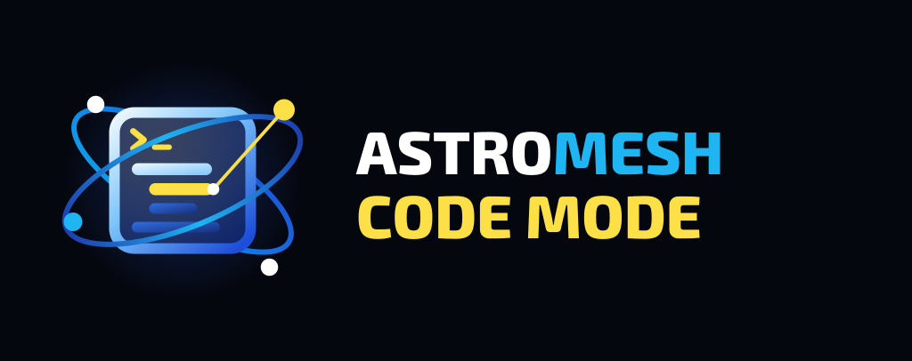

<p align="center">
  
</p>

# astromesh-codemode

**Give your agent two tools instead of two hundred, and let it write the glue in a sandbox.**

[](https://monaccode.github.io/astromesh/#ecosystem)
[](https://github.com/monaccode/astromesh-codemode/actions/workflows/ci.yml)
[](https://www.python.org/)
[](https://github.com/monaccode/astromesh-codemode/blob/main/LICENSE)

*[Leer en español](https://github.com/monaccode/astromesh-codemode/blob/main/README.es.md)*

> **Status: not on PyPI yet.** 0.1.0 is built and tested, but it will not be published until
> the level-2 eval (real models) has run and its table is in this README. See
> [Results](#results).

Classic tool calling sends every tool schema to the model on every call, and every tool
result back through the conversation. With a big catalog, or a tool that returns 500 rows,
most of the context is schemas and data the model only needed to pass along.

Code Mode wraps any set of tools behind two:

- **`codemode_search(query)`** returns the matching tools as typed Python stubs
  (`async def get_customer(customer_id: int) -> dict:` plus its description), ranked with BM25.
- **`codemode_run(code)`** runs a Python program the model wrote, where each tool is an
  `async` function. The program runs in a [Monty](https://github.com/pydantic/monty)
  sandbox (no filesystem, no network, no processes), with limits on time, memory, tool
  calls and output. Intermediate results stay in the sandbox; only what the program
  returns goes back to the model.

It works with plain Python functions, live MCP servers, and eight agent frameworks. It is
not tied to Astromesh; Astromesh will integrate it later.

## Install

```bash
pip install astromesh-codemode                 # core: Python functions, your own loop
pip install 'astromesh-codemode[langchain]'    # plus a framework adapter (see below)
pip install 'astromesh-codemode[mcp]'          # MCP tools as a source, and the MCP proxy
```

Until 0.1.0 is on PyPI, install from a checkout: `uv sync` (or `pip install -e .`).
Python 3.11+.

## Quickstart

Any function with type hints and a docstring becomes a tool. Sync functions run in a thread.

```python
import asyncio

from astromesh_codemode import CodeMode
from astromesh_codemode.sources import from_function


def list_orders(limit: int = 10) -> list[dict]:
    """List recent orders: id, amount, customer_id."""
    return [{"id": i, "amount": 10 + i, "customer_id": i % 5 + 1} for i in range(1, limit + 1)]


def get_customer(customer_id: int) -> dict:
    """Get a customer by id: id and name."""
    return {"id": customer_id, "name": f"Customer {customer_id}"}


cm = CodeMode([from_function(list_orders), from_function(get_customer)])


async def main():
    print(await cm.search("orders"))  # typed stubs, what the model reads
    program = 'orders = await list_orders(limit=500)\nmax(o["amount"] for o in orders)'
    print(await cm.run(program))  # "result: 510": the 500 rows never left the sandbox
    await cm.aclose()


asyncio.run(main())
```

`cm.tool_definitions()` gives the two tools as framework-neutral `NeutralTool`s (name,
description, JSON Schema parameters, async handler), for your own agent loop.
[`examples/functions_quickstart.py`](examples/functions_quickstart.py) is a longer version.

### With LangChain

```python
# needs: langchain_core
from astromesh_codemode.adapters import close_sync
from astromesh_codemode.adapters.langchain import as_tools

tools = as_tools(cm)  # codemode_search and codemode_run as StructuredTools
agent_model = model.bind_tools(tools)  # any LangChain chat model
print(tools[1].invoke({"code": "1 + 1"}))  # what your agent does with a codemode_run call
close_sync(cm)  # sync callers close here; async callers `await cm.aclose()`
```

A full agent loop with a real model is in
[`examples/langchain_crm.py`](examples/langchain_crm.py).

## Frameworks

Each adapter is `astromesh_codemode.adapters.<framework>.as_tools(cm)` and returns the
framework's own tool type. Install the matching extra.

| Framework | Module | Extra | Calls |
|---|---|---|---|
| LangChain | `langchain` | `langchain` | sync and async |
| CrewAI | `crewai` | `crewai` | sync (`run`) and async (`arun`) |
| Google ADK | `adk` | `adk` | async |
| OpenAI Agents SDK | `openai_agents` | `openai-agents` | async |
| PydanticAI | `pydantic_ai` | `pydantic-ai` | async |
| LlamaIndex | `llamaindex` | `llamaindex` | sync (`call`) and async (`acall`) |
| smolagents | `smolagents` | `smolagents` | sync |
| Microsoft Agent Framework | `agent_framework` | `agent-framework` | async |

Sync and async callers, and how to close each: [`docs/frameworks.md`](docs/frameworks.md).

## Tools from MCP servers

`from_mcp(session, prefix=..., read_only=...)` turns the tools of a live MCP session into
Code Mode tools. `astromesh-codemode mcp --config upstream.yaml` runs a proxy: N upstream
MCP servers behind one MCP server that exposes only `codemode_search` and `codemode_run`.
See [`docs/mcp-proxy.md`](docs/mcp-proxy.md).

## Limits, writes and traces

```python
from astromesh_codemode import Limits

strict = CodeMode(
    [from_function(list_orders), from_function(get_customer)],
    name="crm",  # the tools become crm_search and crm_run
    limits=Limits(timeout_s=10, max_memory=32 * 1024 * 1024, max_calls=20, max_output_bytes=8192),
)


async def traced():
    async with strict:
        text, trace = await strict.run_traced("await get_customer(customer_id=3)")
        print(text, [c.tool for c in trace.calls], trace.limit_hit)


asyncio.run(traced())
```

- **`Limits`** (all per run): `timeout_s=30` (wall clock, time waiting on tools included),
  `max_memory=64 MiB` (sandbox heap), `max_calls=50` (tool calls), `max_output_bytes=16384`
  (text returned to the model; longer output is truncated with a notice).
- **Writes are off by default.** A tool built with `writes=True` is invisible to `search`
  and absent from the sandbox unless the `CodeMode` is built with `allow_writes=True`.
- **MCP tools are writes unless proven otherwise**: a tool counts as read-only only when
  the server marks it `readOnlyHint: true` or you list it in `read_only`.
- **Traces.** `run_traced(code)` returns `(text, Trace)`: the code, each tool call
  (`CallRecord`: tool, argument preview, ms, bytes, error), the limit hit, the duration.
  `cm.last_trace` holds the trace of the most recently *finished* `run`: with concurrent
  runs the last to finish wins, so use `run_traced` there. `emit_otel(trace)`
  (`astromesh_codemode.trace`, extra `otel`) exports it as OpenTelemetry spans, without
  argument values unless `include_args=True`.

## Lifecycle: read this before production

- **Close it.** `CodeMode` starts a pool of Monty worker processes on the first `run`.
  Async code: `await cm.aclose()` or `async with CodeMode(...) as cm:`. Sync code (framework
  `invoke`/`run`/`call`): `astromesh_codemode.adapters.close_sync(cm)`. Both are safe to
  call twice, and a later `run` starts a new pool.
- **The pool belongs to one event loop**, the one the first `run` happened on. Do not share
  a `CodeMode` across event loops; sync calls go through one background loop per
  `CodeMode`, so pick sync or async per instance and build one `CodeMode` per style.
- **Do not close while runs are in flight.** Close after the agent is done.
- **Each run starts empty.** No variables survive between runs, and concurrent runs never
  share counters or limits.

## Security

`codemode_run` executes code a model wrote, so the sandbox is tested the way it will be
attacked. `python -m astromesh_codemode.eval traps` runs eleven malicious goals (shell
commands, reading host files, network, endless loops, a hung tool, memory bombs, deep
recursion, calling tools that were not exposed, bad arguments, output floods, the call
budget, and calling a hidden write tool) and checks the **host** for the effect: a marker
file, a token in the output, a connection to a local listener, a handler that ran. With the
default `Limits()` all **11/11 are stopped**, and CI fails if one gets through. Each trap,
and what "stopped" means for it: [`docs/eval.md`](docs/eval.md). What the sandbox does and
does not allow: [`docs/sandbox.md`](docs/sandbox.md).

## Results

### Level 1: context tokens with a scripted model

This is **not** a measurement with real models. A scripted model solves one task ("top 3 of
the last N orders, with their customers") with real tools, the same read-only tools for
both strategies: *direct* (every tool schema on every call, results through the
conversation) against Code Mode (real `search` and real sandboxed `run`). Tokens are
counted with `tiktoken` `o200k_base`. From
[`results/2026-11-25-L1.md`](results/2026-11-25-L1.md):

| catalog | data | strategy | model_calls | context_tokens | output_tokens | ratio codemode/direct |
|---:|---|---|---:|---:|---:|---:|
| 8 | small | direct | 3 | 1989 | 74 |  |
| 8 | small | codemode | 3 | 1897 | 164 | 0.95 |
| 8 | large | direct | 3 | 20799 | 74 |  |
| 8 | large | codemode | 3 | 1897 | 164 | 0.09 |
| 64 | small | direct | 3 | 7578 | 74 |  |
| 64 | small | codemode | 3 | 2073 | 164 | 0.27 |
| 64 | large | direct | 3 | 26388 | 74 |  |
| 64 | large | codemode | 3 | 2073 | 164 | 0.08 |
| 512 | small | direct | 3 | 58047 | 74 |  |
| 512 | small | codemode | 3 | 1897 | 164 | 0.03 |
| 512 | large | direct | 3 | 76857 | 74 |  |
| 512 | large | codemode | 3 | 1897 | 164 | 0.02 |

"small" is 5 rows, "large" 500. ratio < 1: Code Mode carries less context. Read it with
its losses:

- **Code Mode loses on output tokens in every scenario** (164 against 74): writing a
  program costs more than emitting tool calls, and output tokens are usually the
  expensive ones.
- **With few tools and little data it does not pay.** At 8 tools and 5 rows it is about
  even (0.95 of the context, and more output). With only 4 tools and 5 rows Code Mode
  carries **more** context than direct (about 1.3×).
- **The model is scripted**: it never errs, never repairs a program, and its program knows
  result keys the stubs never showed. The way level 1 counts the tools array also favours
  Code Mode at the large catalogs. Level 1 is a floor, not what an agent spends. All its
  limits are in [`docs/eval.md`](docs/eval.md).

### Level 2 (real models): pending

The same scenarios with real models through litellm, counting the tokens and dollars each
strategy actually spends per correct answer, repair loops included. **It has not been run
yet**, so this README makes no claim of the kind "Code Mode pays off from N tools". To run
it (it calls paid APIs; it refuses to start without the provider keys):

```bash
uv run --extra eval python -m astromesh_codemode.eval cost --level 2 --models gpt-4o-mini,gpt-4o
```

**0.1.0 will not be published to PyPI until that table is published here.**

## What it is not

- **Read-only by design in v0.1.** Write tools can be enabled (`allow_writes=True`), but
  there is no confirmation step or per-call approval yet: a program that can call a write
  tool can call it as many times as `max_calls` allows.
- **Not full CPython.** Monty is a Python interpreter written in Rust that implements a
  subset of the language and a few standard modules. No third-party imports, no files, no
  network. Programs that need more belong in a tool.
- **Not a free win.** See the results above: small catalogs with small results are better
  served by plain tool calling.

## Docs

- [`docs/frameworks.md`](docs/frameworks.md): every adapter, sync and async, closing.
- [`docs/sandbox.md`](docs/sandbox.md): what a program can do, limits, errors, traces.
- [`docs/mcp-proxy.md`](docs/mcp-proxy.md): MCP tools as a source, and the proxy.
- [`docs/eval.md`](docs/eval.md): the trap eval and the cost evals, how to reproduce them.
- [`CHANGELOG.md`](CHANGELOG.md).

## License

Apache-2.0.
